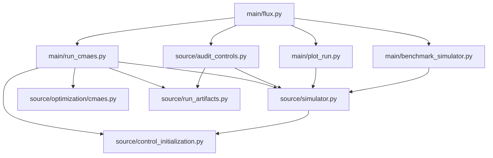

# Pipelines and Dependencies

This document maps the architectural flow and dependencies of the Fluxonium-Optimization project. It is intended to help identify redundancies and guide maintenance.
(it might be outdated soon! It was made like 11/9 or something)

## 1. Core Execution Pipelines

### A. Optimization Pipeline (CMA-ES)

The primary workflow for finding optimal reset pulses.

- **Entry Point:** `main/flux.py run` (or `main/run_cmaes.py`)
- **Flow:**
  1.  **Config Loading:** Reads `config/*.json`.
  2.  **Initialization:** `main/run_cmaes.py` calls `source/control_initialization.py` to set the starting point (zero, random, or piecewise pulse).
  3.  **Simulator Setup:** `source/simulator.py` builds the Hamiltonian in the fixed LC-basis.
  4.  **Optimization:** `source/optimization/cmaes.py` manages candidate sampling and evaluation (serial or multiprocessing).
  5.  **Artifact Generation:** `source/run_artifacts.py` saves the results to `data/output/cmaes/<run_label>/`.
- **Primary Dependencies:** `numpy`, `qutip`, `scqubits`, `multiprocess`, `cma`.

### B. Audit & Validation Pipeline

Ensures that optimization results are numerically stable and converged across basis cutoffs.

- **Entry Point:** `main/flux.py audit` (or `source/audit_controls.py`)
- **Flow:**
  1.  Loads a completed run's `metadata.json` and `best_weights.npy`.
  2.  Re-runs the simulator across a ladder of cutoffs (e.g., 20 -> 40).
  3.  Saves a CSV report (`cutoff_audit_*.csv`) in `local_scratch/`.
- **Primary Dependencies:** `source/simulator.py`, `source/run_artifacts.py`.

### C. Visualization & Analysis Pipeline

Inspects the physical trajectories and optimization history.

- **Entry Point:** `main/flux.py plot` (or `main/plot_run.py`)
- **Flow:**
  1.  Loads `history.csv` (rewards) and `controls.npz` (waveforms).
  2.  Optional: Reproduces detailed pathway populations via `simulator.pathway_diagnostics`.
  3.  Generates a multi-panel Matplotlib figure.
- **Primary Dependencies:** `matplotlib`, `numpy`, `source/simulator.py`.

### D. Benchmarking Pipeline

Measures performance bottlenecks in the simulator.

- **Entry Point:** `main/flux.py benchmark` (or `main/benchmark_simulator.py`)
- **Flow:**
  1.  Measures "Construction time" (building operators) vs "Solve time" (mesolve).
  2.  Supports comparing the current working tree against a historical Git revision in-memory.
- **Primary Dependencies:** `source/simulator.py`, `git` (via subprocess).

## 2. Module Dependency Graph

### Internal Dependencies

### External Dependencies (Core)

| Library        | Purpose                                                    |
| :------------- | :--------------------------------------------------------- |
| `qutip`        | Master Equation solver and quantum operator handling.      |
| `scqubits`     | Fluxonium Hamiltonian construction and LC-basis operators. |
| `numpy`        | Numerical arrays and linear algebra.                       |
| `cma`          | The underlying CMA-ES optimization library.                |
| `multiprocess` | Parallelizing objective evaluations.                       |
| `matplotlib`   | Visualization.                                             |

## 3. Data Flow

1.  **Input:** `config/*.json` (Physics parameters) + CLI Flags (Optimizer settings).
2.  **In-Memory:** `FluxoniumResetSimulator` (Stores cached operators and basis).
3.  **Iteration:** Weights ($\vec{c}$) $\to$ Controls ($\Phi_{ext}(t), \Omega(t)$) $\to$ `mesolve` $\to$ Population ($P_{g0}$).
4.  **Persistent Artifacts:**
    - `metadata.json`: Full configuration, environment snapshot, command used.
    - `summary.json`: Final metrics, SHA256 hashes of other artifacts.
    - `best_weights.npy`: The raw optimization coefficients.
    - `history.csv`: Per-generation reward and sigma.
    - `controls.npz`: Sampled waveforms for easy plotting.

## 4. Identifying Redundancies

- **Simulator logic:** Ensure `source/simulator.py` remains the single source of truth for physics. Avoid copying physics logic into notebooks or analysis scripts; always import the simulator.
- **Control Mapping:** `source/control_initialization.py` owns the mapping between weights and pulses. Any new basis (e.g., splines) should be added there.
- **Artifact Handling:** `source/run_artifacts.py` should be used for all filesystem operations related to saving results to ensure consistent directory structures and hashing.

## 5. Automated Mapping Tools

If the codebase grows significantly, consider these tools for automated dependency tracking:

- **[pydeps](https://github.com/thebjorn/pydeps):** Generates visual graphs of module imports.
  - Usage: `pydeps source/ --exclude qutip numpy scipy`
- **[Pyreverse](https://pylint.readthedocs.io/en/latest/pyreverse.html):** Part of Pylint; generates UML class and package diagrams.
  - Usage: `pyreverse -o png source/`
- **[deptry](https://github.com/fpgmaas/deptry):** Checks for unused, missing, or transitive dependencies in `pyproject.toml`.
  - Usage: `deptry .`
